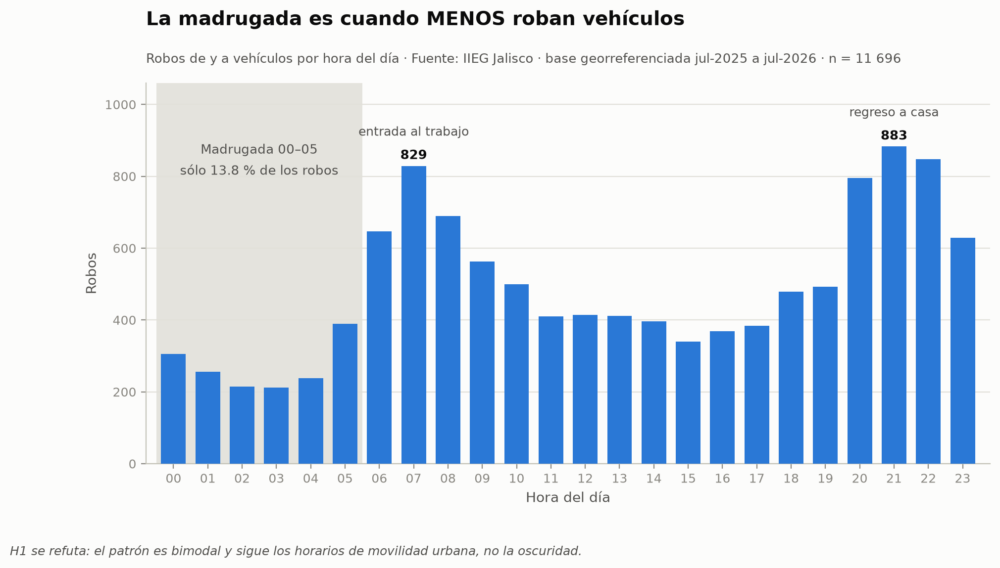
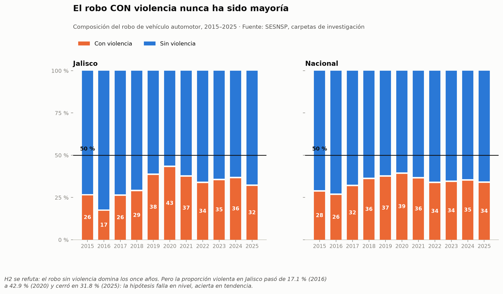
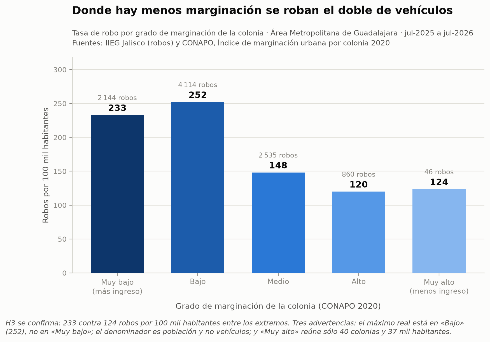
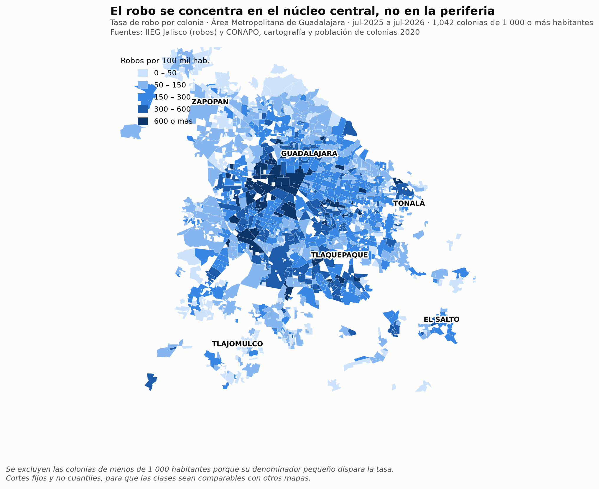

# Robo de vehículos en México y Jalisco

Validación de tres hipótesis sobre el robo vehicular con fuentes oficiales mexicanas.
Dos de ellas resultaron falsas.

Proyecto final de la materia **Visualización de Datos y Narración de Historias**,
Especialidad en Ciencia de Datos, Universidad Panamericana campus Guadalajara.

---

## El problema

Sobre el robo de autos circulan creencias muy extendidas: que ocurre de noche, que casi
siempre es a mano armada, que se concentra donde hay coches caros. Esas ideas orientan
decisiones reales —dónde estacionarse, a qué hora moverse, qué seguro contratar— pero rara
vez se contrastan con datos.

Este proyecto toma tres de esas creencias, las formula como hipótesis y las somete a la
evidencia de tres fuentes oficiales. El objetivo no era confirmarlas, sino aceptar el
resultado fuera cual fuera.

## Resultados

| # | Hipótesis inicial | Veredicto | Evidencia |
|---|---|---|---|
| **H1** | La mayoría de los robos ocurren de noche o madrugada | ❌ **Se refuta** | Distribución bimodal. La madrugada (00:00–05:59) concentra sólo **13.8 %** de los casos; el reparto día/noche queda en 49.5 % contra 50.5 % |
| **H2** | Predomina el robo con violencia | ❌ **Se refuta** | El robo sin violencia es mayoría los **once años** de la serie. Máximo histórico violento en Jalisco: 42.9 % (2020) |
| **H3** | Ocurren más en zonas de altos ingresos | ✅ **Se confirma** | **233** contra **120** robos por 100 mil habitantes entre colonias de marginación muy baja y alta |

La conclusión corta: el robo de vehículos en Jalisco no es un delito nocturno ni
mayoritariamente violento. Es un delito que sigue el pulso de la ciudad —ocurre cuando la
gente se mueve— y se concentra en el núcleo urbano central, no en la periferia.

### H1 · Patrón horario



El patrón es bimodal, con picos a las 07:00 y entre las 20:00 y 22:00. La madrugada, que la
hipótesis señalaba como el momento de mayor riesgo, es el de menor incidencia.

### H2 · Modus operandi



La barra naranja nunca cruza el 50 %. La hipótesis falla en el nivel, pero acierta en la
tendencia: la proporción violenta en Jalisco se multiplicó por 2.5 entre 2016 y 2020.

### H3 · Factor socioeconómico





El gradiente existe y es robusto, pero su mecanismo probable es la **densidad de vehículos**
—hay más autos donde hay más ingreso— y no el valor comercial de cada unidad, que era la
explicación propuesta en el planteamiento original. Ver [Limitaciones](#limitaciones).

---

## Cómo reproducir este análisis

El cuaderno corre de principio a fin sin intervención manual. Descarga por su cuenta el
índice de marginación desde el portal de CONAPO, rehace el cruce espacial y regenera las
cinco figuras.

### Opción A — Google Colab (recomendada, sin instalar nada)

1. Abre [`notebooks/Proyecto_Final_Robo_Vehiculos_Visualizaciones.ipynb`](notebooks/Proyecto_Final_Robo_Vehiculos_Visualizaciones.ipynb) en Colab.
2. Sube estos dos archivos del repositorio al entorno, o déjalos en tu Google Drive:
   - `data/processed/Base_Robo_Vehiculos_Jalisco.xlsx`
   - `data/raw/Estatal-Delitos-2015-2025_jul2026.csv`
3. Ejecuta todas las celdas (`Entorno de ejecución → Ejecutar todas`).

La celda 2 busca los archivos primero en Drive y, si no los encuentra, abre el diálogo de
carga manual. La instalación de `geopandas` tarda cerca de un minuto.

### Opción B — En tu computadora

```bash
git clone https://github.com/PIRATA131/robo-vehiculos-jalisco.git
cd robo-vehiculos-jalisco
python -m venv .venv && source .venv/bin/activate   # en Windows: .venv\Scripts\activate
pip install -r requirements.txt
jupyter notebook notebooks/Proyecto_Final_Robo_Vehiculos_Visualizaciones.ipynb
```

Los archivos de datos ya están en su lugar, así que el cuaderno los encuentra solo.

Si prefieres bajar la fuente de CONAPO por separado, sin abrir el cuaderno:

```bash
python scripts/descargar_conapo.py
```

### Qué esperar

Una corrida completa tarda entre tres y cinco minutos, casi todo en la descarga de CONAPO
(unos 80 MB) y el cruce espacial de 11 696 puntos contra 4 397 polígonos. Al terminar
encontrarás las cinco figuras en `figuras/` y el archivo
`Base_Robo_Vehiculos_Jalisco_con_Marginacion.xlsx` con la base enriquecida.

---

## Estructura del repositorio

```
.
├── notebooks/
│   └── Proyecto_Final_Robo_Vehiculos_Visualizaciones.ipynb   El análisis completo
├── data/
│   ├── raw/
│   │   └── Estatal-Delitos-2015-2025_jul2026.csv             SESNSP, sin modificar
│   ├── processed/
│   │   └── Base_Robo_Vehiculos_Jalisco.xlsx                  IIEG, filtrada y limpia
│   └── README.md                                             Procedencia de cada archivo
├── scripts/
│   └── descargar_conapo.py                                   Descarga el índice de marginación
├── figuras/                                                  Las cinco figuras del reporte
├── docs/
│   ├── Reporte_Final.pdf                                     Reporte académico, 18 páginas
│   └── Presentacion.pdf                                      Presentación, 12 diapositivas
└── requirements.txt
```

---

## Datos

| Fuente | Institución | Qué aporta | Periodo | En el repo |
|---|---|---|---|---|
| Base georreferenciada de incidencia delictiva | IIEG Jalisco | Fecha, hora, colonia y coordenadas de cada robo | jul-2025 a jul-2026 | Sí, ya filtrada |
| Incidencia delictiva del fuero común | SESNSP | Modalidad con y sin violencia | 2015–2025 | Sí, sin modificar |
| Índice de marginación urbana por colonia | CONAPO | Marginación y población por colonia, más cartografía | Censo 2020 | No, se descarga sola |

Los detalles de procedencia, licencias y transformaciones están en
[`data/README.md`](data/README.md).

### Una advertencia sobre el índice de CONAPO

El campo `IM_2020` está **invertido respecto de lo que sugiere su nombre**: un valor alto
significa marginación **baja** (`Muy bajo` ≈ 153, `Muy alto` ≈ 139). El grado `GM_2020` sí
corre en el sentido habitual.

Lo verificamos contrastando ambos campos contra los indicadores crudos: a nivel nacional el porcentaje de
viviendas con hacinamiento sube de 7.5 % en el grado «Muy bajo» a 44.8 % en «Muy alto». Todo
el análisis usa el grado, no el índice numérico. **Quien use `IM_2020` directamente sin
revisar esto obtiene la conclusión exactamente al revés** — la celda 5 del cuaderno reproduce
la comprobación.

---

## Metodología

**Filtrado.** De los 52 366 delitos georreferenciados del estado se conservaron los 11 696
correspondientes a los cuatro delitos de robo vehicular (22.3 %). No se filtraron outliers:
en incidencia delictiva, una colonia con concentración inusual no es ruido sino la señal que
se busca. Sí se excluyeron los 125 registros sin coordenadas (0.23 %).

**Limpieza de la hora.** La variable llegaba en tres formatos mezclados en la misma columna:
texto `HH:MM`, fracciones decimales de Excel (`0.458333333` = 11:00) y notación científica,
más el literal `N.D.`. Se normalizó todo a 24 horas. El 64 % de los registros cae en minuto
`:00` o `:30`, señal de captura redondeada; las `00:00` exactas son sólo 51, de modo que la
medianoche no está inflada por un valor por defecto.

**Cruce espacial.** Se usó *point-in-polygon* (EPSG:4326) y no una unión por nombre de
colonia, que es frágil: los nombres del IIEG y de CONAPO difieren en acentos y abreviaturas
(«Zona Centro» contra «Centro») y hay nombres repetidos en municipios distintos —«Prados del
Nilo» existe en Guadalajara y en San Pedro Tlaquepaque—. **Enlazaron 11 360 de 11 696 robos
(97.1 %)**; los 336 restantes caen en zonas sin polígono de colonia definido.

**Medida de H3.** Tasa por 100 mil habitantes, no conteo bruto: las colonias de marginación
baja no son ni las más numerosas ni las más pobladas, de modo que comparar por conteo
favorecería mecánicamente a los grupos más poblados. Como control de robustez se repitió el
cálculo con quintiles del índice continuo calculados *dentro* del AMG, para corregir el sesgo
de usar los grados nacionales en una zona metropolitana: la razón entre extremos es 1.96.

**Visualización.** Cada figura lleva título-conclusión siguiendo a Knaflic (2015): el título
afirma el hallazgo en vez de describir los ejes, y una nota al pie declara la advertencia
metodológica. La paleta se verificó con un validador de separación perceptual en espacio
OKLab bajo simulación de daltonismo (matrices de Machado, Oliveira y Fernandes), exigiendo
ΔE ≥ 8 entre colores adyacentes. Las variables ordenadas usan rampas de un solo tono.

---

## Limitaciones

Cuatro reservas que afectan la interpretación y conviene declarar:

1. **El denominador de H3 es población, no vehículos.** Las zonas de ingreso alto tienen más
   automóviles por habitante, así que parte del gradiente se explica porque hay más qué
   robar. Esto no refuta la hipótesis, pero cambia su mecanismo: la causa inmediata sería la
   densidad vehicular y no el valor comercial. Separar ambos efectos exigiría el parque
   vehicular por colonia, dato no disponible a esa escala.
2. **Sesgo de denuncia.** Las tres fuentes registran delitos denunciados. En zonas de ingreso
   alto circulan más vehículos asegurados y la aseguradora exige carpeta de investigación
   para pagar, lo que eleva la tasa registrada por una razón administrativa.
3. **Ambigüedad en el campo de fecha.** No está confirmado si la fecha del IIEG corresponde
   al hecho o a la denuncia. De ello depende que la caída observada en fin de semana sea un
   hallazgo real o un artefacto del registro.
4. **El gradiente de H3 no es perfectamente monótono.** El máximo está en el grado «Bajo»
   (252) y no en «Muy bajo» (233). Además «Muy alto» reúne sólo 40 colonias y 37 mil
   habitantes en el AMG, muestra demasiado pequeña para concluir de ese renglón por separado.

### Métricas corregidas respecto de la presentación inicial

Durante el desarrollo, tres cifras de la primera entrega no resistieron el recálculo con las
fuentes primarias. Se documentan aquí por transparencia:

| Cifra presentada | Valor real | Nota |
|---|---|---|
| 58 % en horario diurno | **49.5 %** | No pudo reproducirse con ninguna base del proyecto |
| 55 % con violencia | **42.9 % máximo histórico** | Probablemente venía de la ENVIPE, que mide víctimas encuestadas y no carpetas: universos distintos y no comparables |
| 70 %+ concentrado en el AMG | **84.1 %** | Aquí la estimación inicial se quedó corta |

---

## Referencias

- Bruce, P., Bruce, A. y Gedeck, P. (2020). *Practical Statistics for Data Scientists* (2.ª ed.). O'Reilly Media.
- Consejo Nacional de Población. (2021). [*Índices de marginación 2020*](https://www.gob.mx/conapo/documentos/indices-de-marginacion-2020-284372). CONAPO.
- Huff, D. (1954). *How to Lie with Statistics*. W. W. Norton & Company.
- Instituto de Información Estadística y Geográfica de Jalisco. (2019). *Robo de vehículos en Jalisco*. IIEG.
- Instituto Nacional de Estadística y Geografía. (2023). *Encuesta Nacional de Victimización y Percepción sobre Seguridad Pública (ENVIPE)*. INEGI.
- Knaflic, C. N. (2015). *Storytelling with Data*. John Wiley & Sons.
- Secretariado Ejecutivo del Sistema Nacional de Seguridad Pública. (2026). *Incidencia delictiva del fuero común, nueva metodología, 2015–2025*. SESNSP.

---

## Autor

**César Roberto Murillo Figueroa** — ID 0283143
Especialidad en Ciencia de Datos, Universidad Panamericana campus Guadalajara
Materia: Visualización de Datos y Narración de Historias
Profesor: Dr. Rodolfo Rubén Álvarez González

## Licencia

El **código** de este repositorio se publica bajo licencia MIT (ver [`LICENSE`](LICENSE)).

Los **datos** provienen de fuentes gubernamentales mexicanas de acceso público y conservan
las condiciones de uso de sus instituciones de origen (IIEG Jalisco, SESNSP y CONAPO). Se
redistribuyen aquí únicamente con fines académicos y de reproducibilidad, citando la fuente
en cada caso. Si vas a reutilizarlos, acude a la fuente original: los enlaces están en
[`data/README.md`](data/README.md).
